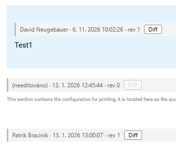
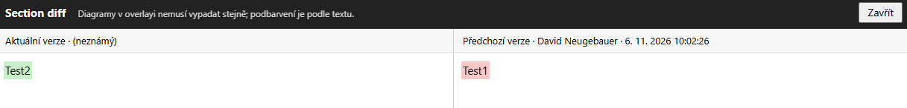

# Tampermonkey skripty

Uživatelské skripty pro [Tampermonkey](https://www.tampermonkey.net/), které rozšiřují aplikace uuBookKit / uuDocKit na Plus4U.

## Instalace

1. Nainstaluj do prohlížeče rozšíření Tampermonkey ([Chrome Web Store](https://chromewebstore.google.com/detail/tampermonkey/dhdgffkkebhmkfjojejmpbldmpobfkfo), [Firefox Add-ons](https://addons.mozilla.org/firefox/addon/tampermonkey/), [Edge Add-ons](https://microsoftedge.microsoft.com/addons/detail/tampermonkey/iikmkjmpaadaobahmlepeloendndfphd)).
2. V tabulce níže klikni u skriptu na **Install**.
3. Tampermonkey otevře instalační stránku. Potvrď ji tlačítkem **Instalovat**.
4. Obnov stránku BookKitu.

Skripty mají v hlavičce `@updateURL`, takže Tampermonkey sám nainstaluje nové verze z tohoto repozitáře.

## Přehled skriptů

| Skript | Popis | Verze | Instalace |
|---|---|---|---|
| [BookKit last editor + section diff](#bookkit-last-editor--section-diff) | Poslední editor u každé sekce a diff s předchozí verzí | 1.0 | [Install](https://raw.githubusercontent.com/David-Neug/Tampermonkey/refs/heads/main/Scripts/bookkit-last-editor-section-diff.user.js) |
| [uuBookKit-ext](#uubookkit-ext) | Vyhledávání stránek, ToC, kopírování odkazů a scénářů, klávesové zkratky | 0.27.2 | [Install](https://raw.githubusercontent.com/David-Neug/Tampermonkey/refs/heads/main/Scripts/uubookkit-ext.user.js) |

---

## BookKit last editor + section diff

Ke každé sekci stránky BookKitu zobrazí, kdo ji naposledy upravil, a umožní ji porovnat s předchozí verzí.

**Spouští se na:** `https://uuapp.plus4u.net/uu-bookkit-maing01/*/book/page*`

### Funkce

- **Lišta posledního editora** nad každou sekcí: jméno (nebo uuIdentity) · datum a čas poslední změny · číslo revize. Needitované sekce mají text „(needitováno)“.
- **Tlačítko „Diff“** otevře celoobrazovkové okno se dvěma panely vedle sebe:
  - vlevo aktuální verze sekce, změny podbarvené **zeleně**,
  - vpravo předchozí verze sekce, odebraný text podbarvený **červeně**.
- Obě verze se vykreslují přes UU5, takže diff ukazuje výsledný vzhled sekce, ne zdrojový uu5string.
- Okno se zavírá tlačítkem **Zavřít**, klávesou **Esc** nebo kliknutím mimo panely.
- Tlačítko je neaktivní, když sekce nemá historickou verzi (revize 0).

### Ukázka

Lišta posledního editora nad sekcemi stránky. Prostřední sekce je v revizi 0 a nikdo ji neupravoval, proto je tlačítko **Diff** neaktivní.

Okno po kliknutí na **Diff**. Vlevo je aktuální verze sekce s přidaným textem podbarveným zeleně, vpravo předchozí verze s odebraným textem podbarveným červeně.

### Jak funguje

- Data sekce (`code`, `sys.mts`, `sys.rev`, editor) čte z React fiberu elementu `.uudcc-bricks-basic-section`.
- Předchozí verzi načítá příkazem `listPageSectionVersion` (výsledky si cachuje pro danou stránku a sekci). Volání jde přes klienta aplikace (`uu_plus4u5g02` / `uu_plus4u5g01` `Calls`), aby se poslala přihlašovací session. Holý `fetch` by server dostal jako anonymní uuIdentity a vrátil by 403.
- Diff se počítá po slovech algoritmem LCS. U velkých sekcí (nad 800 × 800 tokenů) přejde na porovnání po řádcích.
- Stránku sleduje přes `MutationObserver`, takže lišty se doplní i po přechodu na jinou stránku bez obnovení.

### Omezení

- Diagramy a složitější komponenty nemusí v okně s diffem vypadat stejně jako na stránce. Podbarvení se řídí jen textem.

---

## uuBookKit-ext

Sada vylepšení použitelnosti BookKitu a DocKitu. Autoři: Petr Havelka, Josef Jetmar, Aleš Holý, Pavel Zeman ([GitHub](https://github.com/PetrHavelka/uubookkit-ext)).

**Spouští se na:** uuBookKit (`uuapp.plus4u.net/uu-bookkit-maing01`, `uuos9.plus4u.net/uu-bookkitg01-main`), uuDocKit (`uu-dockit-maing02`, `uu-dockitg01-main`), uuNewsKit hub a `docs.plus4u.net`.

**Závislosti:** jQuery 2.1.4 a jQuery UI 1.12.1 (načítá se přes `@require`).

### Funkce

**Vyhledávání a navigace**
- Pole **vyhledávání stránek** v horní liště (Alt+N, Ctrl+Q). Hledá podle všech zadaných slov bez ohledu na diakritiku, zobrazí cestu ve stromu a zahrnuje i skryté stránky. Ovládá se šipkami a Enterem. S podrženým Ctrl se stránka otevře v nové záložce.
- **Rozšiřitelný levý navigační panel**: šířku lze táhnout myší a uloží se do `localStorage`.
- Položky menu mají `title` s celým názvem a **odznak stavu stránky** (T = test, W = rozpracováno, C = uzavřeno).
- **Barevné zvýraznění menu** podle typu stránky: uuSubApp/uuProduct/uuScript/uuLib, Business Model, uuCMD, ObjectStore/BinaryStore/Database.
- Kliknutí na název knihy otevře `docs.plus4u.net`.

**Ikony v hlavičce knihy a stránky**
- Obnovení rozšíření, zapnutí/vypnutí **obsahu stránky (ToC)** s číslováním nadpisů, přepnutí **šířky stránky** na celou obrazovku (stav se pamatuje).
- U nadpisu stránky: odkaz **MD** (lokální editor na `localhost:4323`), **znovunačtení stránky**, **copy link** (formát JIRA) a **copy MD link** (`[název](book:kód)`).

**Kopírování odkazů z menu**
- Po podržení **Ctrl** se u položek menu objeví tlačítka: `CC` kód stránky, `CN` název, `CJL` odkaz ve formátu JIRA, `CMDL` odkaz v Markdownu, `CGTP` tag `UuBookKit.Bricks.GoToPageLink`.

**Scénáře**
- Nad každým číslovaným seznamem v sekci je tlačítko **„Kopírovat programový komentář“**. Zkopíruje kroky jako komentáře `// HDS 1 - …` (u alternativních scénářů s prefixem podle nadpisu), včetně vnořených kroků a zalomení na 150 znaků.
- Číslované seznamy zobrazují plné číslo kroku (např. `2.1.3.`).

**Editace**
- `E` zapne editační režim stránky a otevře všechny sekce. `Shift+E` navíc otevře podsekce (rich text, tabulky, embedded text…). V editačním režimu `E` nebo kliknutí otevře viditelnou tužku.
- `Ctrl+S` uloží a ukončí editaci místo výchozího chování editoru (`Ctrl+Shift+S` zachová původní uložení).
- `Esc` zavře editační dialog, `F4` znovu načte stránku.
- V editoru rich textu se automaticky zapíná kontrola pravopisu.

**Ostatní**
- Odkazy na neexistující stránky v knize jsou **červené**, externí odkazy mají ikonu.
- Kliknutí na nadpis stránky nebo sekce označí jeho text.
- Na stránce komentářů je pole pro **filtrování komentářů** podle kódu stránky (včetně podstránek).

### Jak funguje

Zachytává volání `XMLHttpRequest` a `fetch` (`loadBook`, `loadPage`, `getBookStructure`, `listCommentThreads`, `sys/uuAppWorkspace/load`). Z odpovědí si sestaví index stránek pro vyhledávání a po načtení každé stránky znovu doplní ikony a úpravy.
